# TP DAR – Calculatrice Client/Serveur TCP (Java)


---

##  Description

Application **client/serveur** en Java utilisant les **sockets TCP** pour réaliser une calculatrice distante.  
Le client envoie un choix d'opération et un entier au serveur, qui effectue le calcul et renvoie le résultat.

L'opérande fixe côté serveur est **5** : toutes les opérations se font entre `x` (saisi par l'utilisateur) et `5`.

---

##  Structure du projet

```
tp_dar/
├── src/
│   ├── clientpackage/
│   │   └── Client.java       # Client TCP (menu interactif)
│   ├── serverpackage/
│   │   └── Server.java       # Serveur TCP (calcul à distance)
│   └── Main.java
├── captures/                 # Captures d'écran de démonstration
├── .gitignore
└── tp_dar.iml
```

---

##  Prérequis

| Outil | Version utilisée |
|-------|-----------------|
| Java (JDK) | OpenJDK 17.0.18 |
| Git | 2.52.0 (Windows) |
| IDE | IntelliJ IDEA |

### Vérification de Java

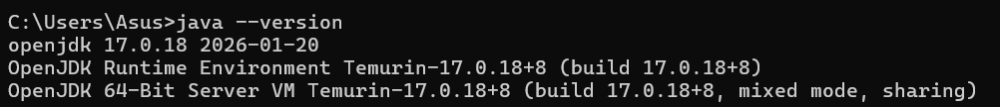

### Vérification de Git

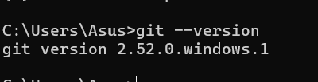

---

##  Lancement de l'application

### 1. Ouvrir le projet dans IntelliJ IDEA

Le projet contient deux packages dans `src/` :

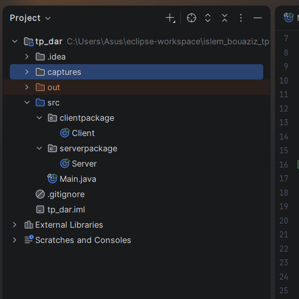

---

### 2. Démarrer le Serveur

Exécuter la classe `serverpackage.Server`.  
Le serveur détecte automatiquement l'adresse IP locale et écoute sur le port **1234** par défaut.

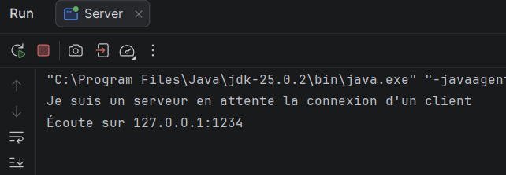

---

### 3. Démarrer le Client

Exécuter la classe `clientpackage.Client`.  
Le client tente de se connecter à `localhost:1234`.

**Avant connexion :**

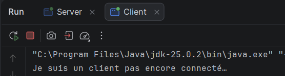

**Après connexion réussie :**

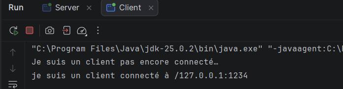

---

##  Utilisation – Menu de la calculatrice

Le client affiche un menu interactif avec 4 opérations (toutes effectuées avec l'opérande **5**) :

```
===== CALCULATRICE =====
1. Addition        (x + 5)
2. Soustraction    (x - 5)
3. Multiplication  (x * 5)
4. Division        (x / 5)
0. Quitter
```

### Exemples de calculs

#### ➕ Addition : `10 + 5 = 15.0`

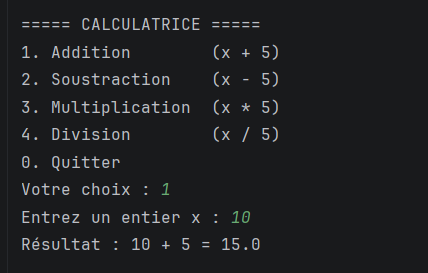

#### ➖ Soustraction : `10 - 5 = 5.0`

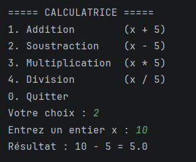

#### ✖️ Multiplication : `-4 * 5 = -20.0`

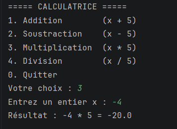

#### ➗ Division : `7 / 5 = 1.4`

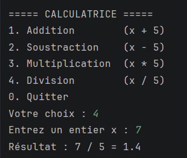

#### ➗ Division : `0 / 5 = 0.0`

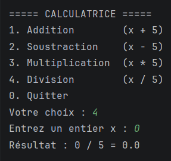

#### 🔚 Quitter (choix 0)

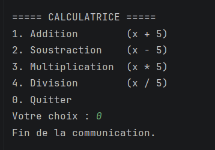

---

##  Côté Serveur – Logs

### Connexion d'un client

Lorsqu'un client se connecte, le serveur affiche son adresse IP :

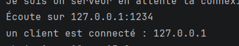

### Récapitulatif des calculs effectués

Le serveur journalise chaque opération reçue et le résultat calculé :

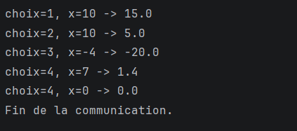

---

## 🔄 Protocole de communication

```
Client                          Serveur
  |                                |
  |-- writeInt(choix) -----------> |
  |-- writeInt(x) --------------> |   (si choix != 0)
  |                                |-- calcul(choix, x)
  |<-- writeDouble(résultat) ----- |
  |         ...                    |
  |-- writeInt(0) --------------> |   (quitter)
  |                                |-- Fin de la communication
```

| Choix | Opération       | Formule  |
|-------|-----------------|----------|
| 1     | Addition        | `x + 5`  |
| 2     | Soustraction    | `x - 5`  |
| 3     | Multiplication  | `x * 5`  |
| 4     | Division        | `x / 5`  |
| 0     | Quitter         | —        |

---

## 🌐 Configuration réseau

- **Port par défaut :** `1234`
- Le serveur détecte automatiquement son adresse IPv4 locale (hors loopback).
- Arguments optionnels :
  - **Serveur :** `java serverpackage.Server [adresseIP] [port]`
  - **Client :** `java clientpackage.Client [adresseIP_serveur] [port]`

---

## 📁 Index des captures

Toutes les captures sont disponibles dans le dossier [`captures/`](captures/).

| Fichier | Description |
|---------|-------------|
| `img.png` | Version Java installée |
| `img_1.png` | Version Git installée |
| `img_2.png` | Structure du projet dans l'IDE |
| `img_3.png` | Serveur en attente de connexion |
| `img_4.png` | Client avant connexion |
| `img_5.png` | Client connecté |
| `img_6.png` | Addition : 10 + 5 = 15.0 |
| `img_7.png` | Soustraction : 10 - 5 = 5.0 |
| `img_8.png` | Multiplication : -4 * 5 = -20.0 |
| `img_9.png` | Division : 7 / 5 = 1.4 |
| `img_10.png` | Division : 0 / 5 = 0.0 |
| `img_11.png` | Fin de communication (client) |
| `img_12.png` | Serveur : client connecté |
| `img_13.png` | Logs serveur – récapitulatif |


